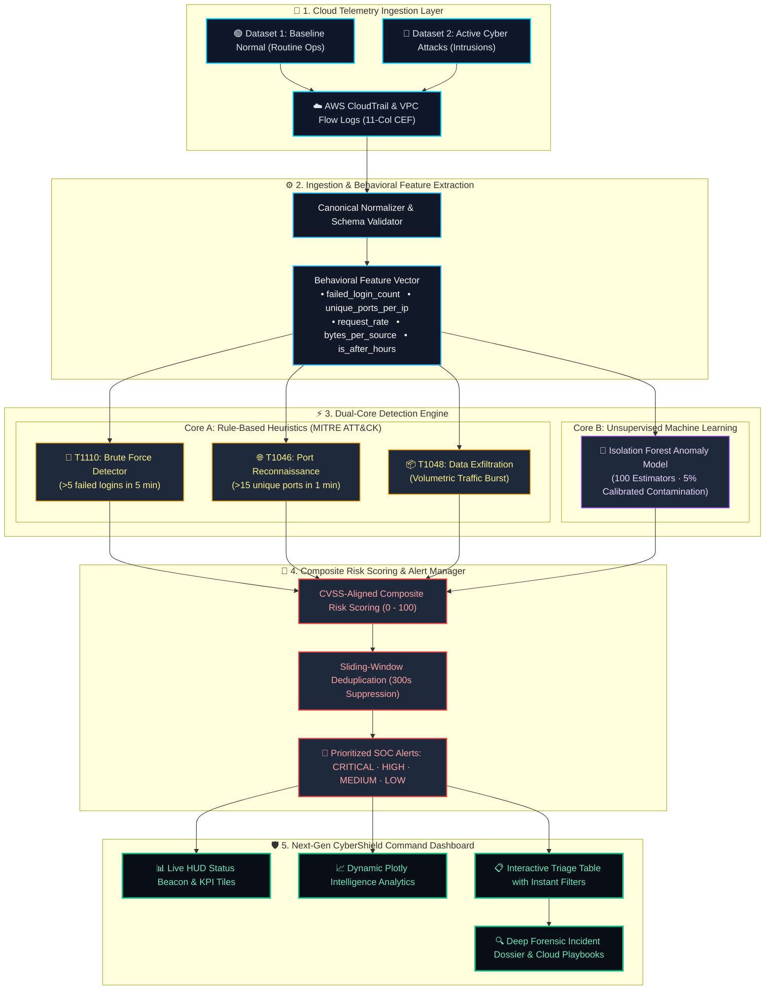

# 🛡️ Cloud-Based Cyber Threat Detection Dashboard

[](https://cloud-cyber-threat-detection-dashboard-sruvkhzhhjelddy9unmbhn.streamlit.app/)


---

## 🌐 Live Cloud Deployment
- **Live Streamlit App**: [cloud-cyber-threat-detection-dashboard.streamlit.app](https://cloud-cyber-threat-detection-dashboard-sruvkhzhhjelddy9unmbhn.streamlit.app/)
- **GitHub Repository**: [Adhithya-kn/cloud-cyber-threat-detection-dashboard](https://github.com/Adhithya-kn/cloud-cyber-threat-detection-dashboard)

---

## Overview

The **Cloud-Based Cyber Threat Detection Dashboard** is a real-time security operations centre (SOC) tool built with Python and Streamlit. It ingests cloud network telemetry, applies a dual-layer detection pipeline (rule-based heuristics + machine-learning Isolation Forest anomaly detection), computes CVSS-aligned composite risk scores (0–100), and provides an interactive forensic investigation workbench with MITRE ATT&CK® mapping.

### 🌟 Demonstration Scenarios (Two Curated Datasets):
1. **🟢 Dataset 1: Normal Cloud Activity (Routine Baseline)**: 300 telemetry events representing healthy cloud workloads, authorized administrative logins, and benign web traffic. Verifies zero false alarms and healthy operational status.
2. **🚨 Dataset 2: Active Cyber Attack Incidents (Intrusions & Threats)**: 610 multi-vector telemetry events featuring real SSH brute-force credential attacks, network port sweeps, and abnormal data exfiltration spikes. Flagged by heuristic rules and Isolation Forest ML.

---

## 🏛️ End-to-End System Architecture



### 🧩 Architectural Layer Breakdown

| Layer | Component | Function & Engineering Purpose |
| :--- | :--- | :--- |
| **1. Telemetry Ingestion** | Cloud Telemetry Feeds | Ingests real-world telemetry modeled after AWS VPC Flow Logs and CIC-IDS2017 intrusion benchmarks. |
| **2. Feature Engineering** | Feature Extraction Pipeline | Dynamically computes 5 behavioral metrics (`failed_login_count`, `unique_ports_per_ip`, `request_rate`, `bytes_per_source`, `is_after_hours`). |
| **3. Dual-Core Detection** | Heuristics + Isolation Forest | **Core A** applies deterministic rules mapped to MITRE ATT&CK; **Core B** uses unsupervised ML to isolate multidimensional outliers. |
| **4. Risk Engine & Triage** | CVSS Scorer & Deduplication | Computes weighted 0–100 risk scores, classifies into 4 severity bands, and suppresses duplicate alerts within a 300s window. |
| **5. Command Center UI** | Streamlit Next-Gen Cyber SOC | Delivers a radar status beacon, live HUD metric tiles, dynamic Plotly charts, interactive triage tables, and forensic playbooks. |

---

## Features

### 📊 Streamlined Demonstration Interface

| Component | Description |
|-----------|-------------|
| **Operational Status & KPIs** | Live health banner (Safe vs Attack in progress), ingested event counters, active alerts, high/critical severity metrics, and average risk index |
| **Analytic Graphs** | Dynamic Plotly visualizations that vary by dataset: threat distribution donut, severity breakdown, telemetry timeline spike detection, and top offending IPs / target ports |
| **Alerts & Deep Forensic Dossier** | Filterable table by severity, threat category, and source IP; interactive inspection of any alert to view root cause narrative, MITRE ATT&CK technique, dual-engine validation, and recommended cloud countermeasures |
| **Security Logs Table** | Searchable & filterable stream of raw telemetry events with search by IP or event type |
| **Executive Dossier** | Human-readable executive summary and one-click export for reports (TXT) and alerts (CSV) |

### 🔍 Detection Engine

- **Rule-Based Heuristics** — configurable sliding-window counters for brute-force (5 failures / 5 min), port scans (15 ports / 60 s), and traffic spikes (10 MB / 60 s)
- **ML Anomaly Detection** — Isolation Forest trained on four network-behaviour features; contamination rate tunable from the dashboard
- **Risk Scoring** — weighted base scores per threat category, boosted for hits on critical ports (SSH, RDP, SMB), mapped to four severity bands (LOW, MEDIUM, HIGH, CRITICAL)
- **Alert Deduplication** — suppress repeated alerts from the same source within a 300s window to reduce analyst fatigue


---

## Tech Stack

| Component | Library | Version |
|-----------|---------|---------|
| Dashboard framework | [Streamlit](https://streamlit.io) | ≥ 1.28 |
| Data manipulation | [Pandas](https://pandas.pydata.org) | ≥ 2.0 |
| Numerical computing | [NumPy](https://numpy.org) | ≥ 1.24 |
| Machine learning | [scikit-learn](https://scikit-learn.org) | ≥ 1.3 |
| Interactive charts | [Plotly](https://plotly.com/python/) | ≥ 5.17 |
| Model persistence | [Joblib](https://joblib.readthedocs.io) | ≥ 1.3 |
| Date utilities | [python-dateutil](https://dateutil.readthedocs.io) | ≥ 2.8 |

---

## Project Structure

```
cloud-cyber-threat-detection-dashboard/
├── .streamlit/
│   └── config.toml          # Dark SOC theme, server settings
├── detection/
│   ├── config.py            # Detection thresholds & constants
│   ├── rules.py             # Rule-based heuristic detectors
│   ├── anomaly.py           # Isolation Forest ML anomaly detector
│   └── risk_score.py        # Composite CVSS risk scoring engine
├── utils/
│   ├── log_parser.py        # Schema validation & feature extraction
│   ├── alert_manager.py     # Alert deduplication & persistence
│   └── pipeline.py          # Unified pipeline & session initializer
├── data/
│   ├── dataset_1_normal_baseline.csv        # 300-event clean operational baseline
│   ├── demo_security_logs.csv               # 610-event multi-vector intrusion logs
│   ├── cic_ids2017_historical_benchmark.csv # Real UNB benchmark intrusion data
│   ├── aws_honeypot_attacks.csv             # Real AWS cloud honeypot telemetry
│   ├── generate_demo_data.py                # Telemetry generator script
│   └── alerts.csv                           # Triaged alert records
├── models/
│   └── isolation_forest.pkl # Pre-trained anomaly model bundle
├── tests/
│   ├── test_detection_rules.py   # Detection & risk score tests
│   ├── test_cloud_environment.py # Cloud & container specs tests
│   └── test_cloud_api.py         # Starlette API endpoint tests
├── app.py                   # Streamlit cyber SOC dashboard (Next-Gen UI)
├── api.py                   # Starlette Cloud SOC API Gateway
├── Dockerfile               # Container deployment specification
├── requirements.txt         # Production dependencies
└── README.md
```

---

## Setup & Installation

### Prerequisites

- Python **3.10 or higher**
- `pip` package manager
- Git

### 1 — Clone the Repository

```bash
git clone https://github.com/<your-username>/cloud-cyber-threat-detection-dashboard.git
cd cloud-cyber-threat-detection-dashboard
```

### 2 — Create a Virtual Environment (Recommended)

```bash
python -m venv .venv
source .venv/bin/activate      # macOS / Linux
# .venv\Scripts\activate       # Windows PowerShell
```

### 3 — Install Dependencies

```bash
pip install --upgrade pip
pip install -r requirements.txt
```

### 4 — Run the Dashboard

```bash
streamlit run app.py
```

Open your browser at **http://localhost:8501**.  
The synthetic data generator starts automatically; no external data source is required.

### 5 — (Optional) Train / Retrain the ML Model

```bash
python -m detection.ml_detector --train
```

This generates `models/isolation_forest.pkl` using the synthetic dataset. The dashboard loads this model automatically on the next run.

---

## Data Sources

### Reference Datasets

| Dataset | Description | URL |
|---------|-------------|-----|
| **CICIDS 2017** | Canadian Institute for Cybersecurity Intrusion Detection dataset — 15 attack categories over 5 days of pcap captures | [UNB CICIDS2017](https://www.unb.ca/cic/datasets/ids-2017.html) |
| **NSL-KDD** | Refined version of the KDD Cup 1999 dataset; widely used ML IDS benchmark | [NSL-KDD](https://www.unb.ca/cic/datasets/nsl.html) |

> **Note** — The live dashboard operates on **synthetic data** generated by `utils/data_generator.py`. The generator's statistical distributions are modelled on CICIDS2017 feature ranges. To use real data, replace the generator with your own ETL pipeline and point `EVENT_STORAGE_PATH` in `detection/config.py` to your data file.

---

## Deployment

### Streamlit Community Cloud (Free Tier)

1. **Fork or push** this repository to your GitHub account.
2. Go to [share.streamlit.io](https://share.streamlit.io) and click **New app**.
3. Select your repository, branch (`main`), and entry point (`app.py`).
4. Click **Deploy** — Streamlit Cloud installs `requirements.txt` automatically.
5. Your dashboard will be live at `https://<your-app>.streamlit.app`.

### Docker (Self-Hosted)

```dockerfile
FROM python:3.11-slim
WORKDIR /app
COPY requirements.txt .
RUN pip install --no-cache-dir -r requirements.txt
COPY . .
EXPOSE 8501
CMD ["streamlit", "run", "app.py", "--server.address=0.0.0.0"]
```

```bash
docker build -t cyber-threat-dashboard .
docker run -p 8501:8501 cyber-threat-dashboard
```

### Environment Variables

| Variable | Default | Description |
|----------|---------|-------------|
| `STREAMLIT_SERVER_PORT` | `8501` | Override the listening port |
| `DASHBOARD_REFRESH_INTERVAL` | `5` | Live monitor refresh rate (seconds) |
| `ANOMALY_CONTAMINATION` | `0.05` | ML contamination rate (overrides config.py) |

---

## Testing

Unit tests are located in the `tests/` directory:

```bash
python -m unittest discover tests
```

| Test File | Coverage |
|-----------|----------|
| `test_detection_rules.py` | Brute-force, port-scan, traffic-spike rule logic & risk scoring |
| `test_cloud_environment.py` | Cloud telemetry pipeline & environment specifications |
| `test_cloud_api.py` | Cloud SOC ingestion & mitigation API endpoint tests |

---

## Security Notes

- **No real credentials are stored.** All data is synthetic; the dashboard is a demonstration tool.
- The Streamlit server is configured with `enableCORS = false` — do not expose port 8501 directly to the public internet without a reverse proxy and authentication layer (e.g., Nginx + OAuth2 Proxy).
- For production deployments, enable HTTPS via a TLS-terminating load balancer or Caddy/Nginx.
- Alert and event CSV files (`data/`) may contain sensitive IP addresses in real deployments — apply appropriate filesystem permissions and encryption at rest.

---

## Dataset Attribution

> Sharafaldin, I., Habibi Lashkari, A., & Ghorbani, A. A. (2018).
> **Toward Generating a New Intrusion Detection Dataset and Intrusion Traffic Characterization.**
> *Proceedings of the 4th International Conference on Information Systems Security and Privacy (ICISSP)*, 108–116.
> Canadian Institute for Cybersecurity, University of New Brunswick.

> Tavallaee, M., Bagheri, E., Lu, W., & Ghorbani, A. A. (2009).
> **A Detailed Analysis of the KDD CUP 99 Data Set.**
> *Proceedings of the IEEE Symposium on Computational Intelligence in Security and Defense Applications (CISDA)*.

---

## License

This project is licensed under the **MIT License**.

```
MIT License

Copyright (c) 2024 Cp-01

Permission is hereby granted, free of charge, to any person obtaining a copy
of this software and associated documentation files (the "Software"), to deal
in the Software without restriction, including without limitation the rights
to use, copy, modify, merge, publish, distribute, sublicense, and/or sell
copies of the Software, and to permit persons to whom the Software is
furnished to do so, subject to the following conditions:

The above copyright notice and this permission notice shall be included in all
copies or substantial portions of the Software.

THE SOFTWARE IS PROVIDED "AS IS", WITHOUT WARRANTY OF ANY KIND, EXPRESS OR
IMPLIED, INCLUDING BUT NOT LIMITED TO THE WARRANTIES OF MERCHANTABILITY,
FITNESS FOR A PARTICULAR PURPOSE AND NONINFRINGEMENT. IN NO EVENT SHALL THE
AUTHORS OR COPYRIGHT HOLDERS BE LIABLE FOR ANY CLAIM, DAMAGES OR OTHER
LIABILITY, WHETHER IN AN ACTION OF CONTRACT, TORT OR OTHERWISE, ARISING FROM,
OUT OF OR IN CONNECTION WITH THE SOFTWARE OR THE USE OR OTHER DEALINGS IN
THE SOFTWARE.
```

---

*Built with ❤️ for the security community.*
